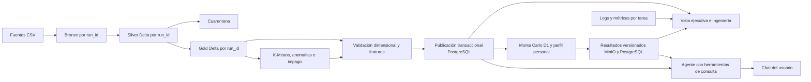
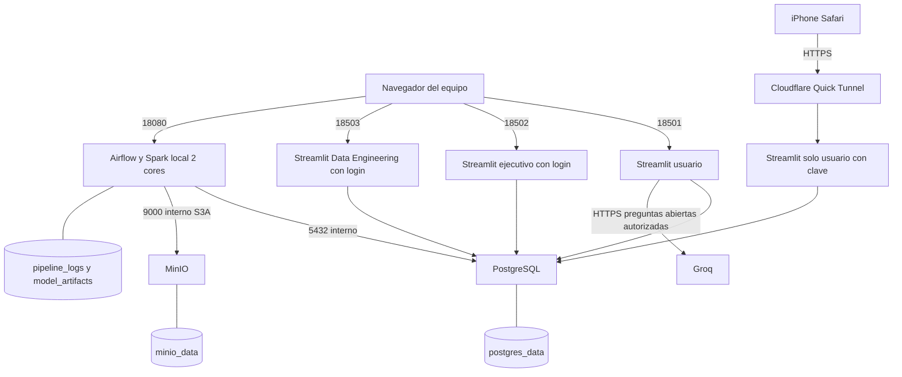

# Gemelo Digital Financiero Personal

Documento de arquitectura de la implementación integrada. Actualizado el 10 de noviembre de 2026.

## Propósito y alcance

El proyecto académico BBVA–Tecmilenio construye una plataforma de Ingeniería de Datos con capas Bronze, Silver y Gold, calidad declarativa, orquestación, publicación analítica y una experiencia conversacional. Los resultados de negocio dependen de fuentes públicas independientes. El pipeline procesa transacciones personales, comportamiento de tarjetas y perfiles sintéticos.

La versión integrada vive en la carpeta `Gemelo Digital Financiero BBVA`. Se creó a partir de `Gemelo-Digital-Financiero 23.21.16`, conservando sus fuentes CSV, contratos Gold y transformaciones analíticas. Sus volúmenes Docker son independientes. La información de la instalación anterior se puede conservar y auditar por separado.

## Flujo de información

La publicación PostgreSQL se realiza después de validar las tres ramas originales, las anomalías, el modelo supervisado y el perfil personal. Un único puntero selecciona la publicación activa. Todas las tablas de esa fotografía se insertan en una transacción antes de mover el puntero. Una falla revierte la transacción y permite seguir consultando la fotografía anterior.

Las simulaciones se calculan después de publicar Gold. Tienen un ciclo de vida independiente y pueden recalcularse desde una publicación existente. Una falla de simulación deja disponible Gold y aparece como falla de su tarea.

## Fuentes y semántica

| Fuente | Grano de origen | Uso | Identidad y unidad |
| --- | --- | --- | --- |
| Dataset 1 | Movimiento con fecha, categoría, importe y tipo | Flujo mensual, composición del gasto y Monte Carlo | Sin identificador personal. Moneda sin confirmar |
| Dataset 2 | Cliente de tarjeta `cust_id` | Utilización, segmentación y anomalías | Población propia. Moneda sin confirmar |
| Dataset 3 | Usuario y fecha de registro | Perfil sintético y variables de negocio | `user_id` y `record_date`. Campos monetarios en USD |

Los identificadores de Dataset 2 y Dataset 3 pertenecen a poblaciones independientes. El modelo dimensional conserva dimensiones separadas y valida las relaciones internas de cada fuente. Dataset 1 representa un perfil transaccional demostrativo. El flujo acumulado histórico no identifica el ahorro disponible en una cuenta.

## Almacenamiento y versionado

Bronze conserva el archivo CSV original byte por byte mediante MinIO y añade metadatos con SHA-256, cantidad de registros, columnas y fecha de ingesta. El reintento de un mismo `run_id` exige el mismo hash de la fuente. Una fuente modificada requiere una corrida nueva.

Las rutas tienen la forma `s3a://<capa>/<dataset>/run_id=<id_seguro>/`. El identificador seguro conserva una versión normalizada y un sufijo SHA-256 de doce caracteres para evitar colisiones entre identificadores con signos diferentes. Todas las etapas usan la misma función. Silver consume exclusivamente la partición Bronze de su corrida. Las rutas históricas basadas en `ingestion_date` permanecen en la instalación anterior y requieren una nueva ingesta o una migración explícita para incorporarse a esta versión.

Silver válido y Gold se almacenan en Delta Lake sobre MinIO. Las rutas Parquet de corridas anteriores se pueden seguir leyendo. Las escrituras se pueden repetir dentro de una corrida antes de publicar. PostgreSQL conserva fotografías publicadas inmutables. Una repetición de publicación compara hashes del contenido analítico, excluyendo timestamps de procesamiento, y rechaza cambios bajo un identificador ya publicado.

La consistencia entre objetos MinIO y PostgreSQL se administra mediante el manifiesto de publicación. Los consumidores consultan publicaciones confirmadas. Si una escritura de objetos termina y la transacción SQL falla, pueden quedar objetos sin referencia que el reintento puede completar. Una publicación confirmada tiene referencia y checksums.

## Calidad y conciliación

Los contratos Silver en `schemas/dataset*_schema.json` declaran tipos, nulabilidad, dominios, límites y llaves. El motor PySpark normaliza texto y valores booleanos, interpreta fechas de los formatos aceptados y convierte importes con punto decimal y coma de miles. Los valores no interpretables se separan hacia cuarentena.

La deduplicación se ejecuta después de normalizar. Las llaves con filas conflictivas se ponen en cuarentena. Dataset 3 permite varias fechas por usuario y usa la llave compuesta. Los campos del préstamo son obligatorios cuando `has_loan` es verdadero. `loan_type` puede ser nulo cuando no aplica. Los importes negativos de tarjetas y perfiles se rechazan según los contratos. Dataset 1 conserva el signo de origen y Gold agrega magnitudes absolutas separadas por tipo de movimiento, por compatibilidad con la convención del proyecto.

Cada corrida concilia la identidad `leídos = duplicados eliminados + cuarentena + válidos`. Se registran las cantidades por regla y el número de reglas con incumplimientos. Las reglas se ejecutan con expresiones nativas de Spark sobre contratos declarativos. Great Expectations y dbt son alternativas descritas en la propuesta original y no forman parte del motor ejecutado por esta versión.

Los contratos Gold existentes bloquean tipos incorrectos, nulos en campos obligatorios, llaves repetidas, rangos inválidos y diferencias aritméticas. La publicación añade validaciones entre hechos y dimensiones, conciliación entre gasto mensual y categorías y cobertura uno a uno de clientes de tarjeta con features de anomalías.

El porcentaje de registros rechazados se calcula como `100 × cuarentena / leídos`, exclusivamente en tareas Silver. El resumen usa el último intento de cada tarea para evitar contar los reintentos como nuevos volúmenes. Los duplicados eliminados y las reglas fallidas se muestran por separado. Un conjunto vacío se presenta como ausencia de datos.

## Modelo dimensional

| Relación | Grano publicado | Llave | Dimensiones |
| --- | --- | --- | --- |
| `gold.monthly_cashflow` | Corrida y mes | `source_run_id, period_month` | `serving.dim_month` |
| `gold.category_spending` | Corrida, mes y categoría | `source_run_id, period_month, category` | Mes y `serving.dim_category` |
| `gold.credit_cards` | Corrida y cliente de tarjeta | `source_run_id, cust_id` | `serving.dim_card_customer` |
| `gold.financial_profiles` | Corrida, usuario y fecha | `source_run_id, user_id, record_date` | `serving.dim_profile_user` |

Las dimensiones se materializan como vistas de lectura de la fotografía activa. PostgreSQL aplica llaves primarias y una llave foránea entre categorías y flujo mensual. La comprobación de cobertura de tarjetas y anomalías ocurre antes de publicar. El manifiesto guarda los resultados de validación, rutas, conteos y hashes.

Esta implementación usa una constelación de hechos por fuente. Las dimensiones son vistas derivadas y el historial se versiona por publicación. Para adoptar dimensiones físicas con SCD se deberá ampliar el contrato y la estrategia de historización.

## Feature Store del MVP

El Feature Store es offline y se implementa mediante fotografías versionadas y vistas SQL.

| Conjunto | Entidad | Variables principales | Disponibilidad |
| --- | --- | --- | --- |
| `serving.card_features` | Corrida y `cust_id` | Utilización, ratios de pago, segmento, score y bandera de anomalía | `available_at` de publicación y `card-features-v1` |
| `serving.profile_features` | Corrida, `user_id` y fecha | Capacidad mensual estimada, meses de emergencia y score | `available_at` de publicación y `profile-features-v1` |

El manifiesto registra el grano y las validaciones. `gold.publications.published_at` determina cuándo una feature estaba disponible para consumo. Un entrenamiento retrospectivo debe seleccionar una publicación con disponibilidad anterior o igual a su fecha de corte y respetar `record_date`. Las vistas activas sirven para inferencia actual. El historial de `gold.*` permite reconstruir una fotografía pasada con permisos de ingeniería.

La capacidad mensual del perfil conserva la fórmula existente `ingreso - gastos - EMI`. Su interpretación depende de que los gastos reportados excluyan la cuota del préstamo. Esta condición debe confirmarse con la fuente antes de usarla en una decisión. Los indicadores de elegibilidad y límite sugerido son heurísticas académicas existentes.

## Modelos de tarjetas

Gold Dataset 2 conserva K-Means con cuatro segmentos, semilla 42 y estandarización. Sus etiquetas identifican grupos estadísticos y requieren interpretación según sus características. El script exploratorio `cluster_credit_cards_dataset2.py` permite comparar varios valores de K, y el DAG usa la segmentación estable incluida en la transformación Gold.

Isolation Forest consume exclusivamente la corrida correspondiente, ordenada por `cust_id`, y genera scores, ratios de pago y bandera de anomalía. Se ejecuta con 200 árboles, contaminación 0.02 y semilla 42. Guarda el modelo y las métricas bajo `models/`, además de publicar las anomalías en MinIO. Una anomalía describe una observación atípica. La probabilidad de impago se calcula por un modelo supervisado independiente sobre UCI; no se atribuye una etiqueta de impago a Dataset 2.

## Monte Carlo de Dataset 1

El modelo utiliza `gold.monthly_cashflow` de una publicación explícita o de la publicación activa al iniciar el cálculo. Requiere entre tres y 1,200 meses válidos, contiguos y únicos, con ingresos y gastos finitos y no negativos. Dataset 1 original contiene 60 meses entre enero de 2020 y diciembre de 2024.

### Saldo inicial

`initial_savings` es el saldo líquido disponible al comienzo del primer mes proyectado, en la misma unidad monetaria de Dataset 1. Lo proporciona el usuario por chat o el operador en la configuración del DAG. El DAG usa `MC_INITIAL_SAVINGS`, cuyo valor inicial es cero y representa una hipótesis de arranque. El agente solicita el saldo si el usuario aún no lo proporcionó. Los ahorros de Dataset 3 y la suma histórica del flujo no se usan como saldo inicial porque pertenecen a conceptos o poblaciones diferentes.

### Muestreo y ecuación

Cada trayectoria sortea meses históricos con reemplazo. El ingreso y el gasto del mes sorteado permanecen emparejados para conservar su dependencia contemporánea. Los meses futuros se muestrean de forma independiente, con la misma distribución empírica histórica. Todos los escenarios de una corrida comparten las mismas muestras aleatorias.

Para un escenario con cambio de ingreso `a`, cambio de gasto `b` y gasto mensual adicional `c`, el saldo se calcula mediante `saldo[t] = saldo[t-1] + ingreso_sorteado[t] × (1+a/100) - gasto_sorteado[t] × (1+b/100) - c`.

### Supuestos documentados

- Se omiten estacionalidad, inflación, tendencia, rendimientos del ahorro e intereses de deuda.
- El periodo histórico observado se toma como referencia para la distribución futura. El remuestreo no genera shocks fuera de los valores históricos, salvo los cambios explícitos de escenario.
- La independencia temporal omite rachas y autocorrelación entre meses. El muestreo pareado conserva la relación ingreso–gasto dentro de un mes.
- Se asume que los movimientos representan suficientemente cada mes. La agregación disponible no permite verificar que los meses extremos estén completos. El usuario debe confirmar su cobertura antes de interpretar la proyección.
- Un mes sin datos bloquea el cálculo. Su ausencia requiere revisión de cobertura.
- Los saldos negativos representan déficit acumulado. No se aplican límites de crédito ni cargos por financiar ese déficit.
- La simulación conserva la unidad monetaria de origen, cuya moneda permanece pendiente de confirmar.
- Más trayectorias reducen la variación por muestreo Monte Carlo y mantienen las limitaciones de la historia y de los supuestos.
- La reproducción exige la misma historia ordenada, semilla, configuración, versión del modelo y versiones de NumPy/Pandas.

### Parámetros y escenarios

Los valores iniciales son 5,000 trayectorias por escenario, horizonte de 12 meses y semilla 42. El usuario puede ajustarlos por conversación. El DAG permite ajustar saldo inicial, horizonte, trayectorias, semilla, cambio de gastos y gasto recurrente adicional. El DAG independiente acepta la configuración completa en JSON.

Se permiten de 100 a 50,000 trayectorias, de 1 a 60 meses y hasta cinco escenarios. Los escenarios iniciales son base, gastos +10% e ingresos -10%. Los cambios porcentuales aceptan valores entre -100% y +200%. Los parámetros usan puntos porcentuales, por lo que 10 representa 10%. Las etiquetas con cambios explícitos, como Gastos +10%, deben coincidir con su parámetro y se rechazan si difieren. Se limita el gasto adicional a un valor finito entre cero y 1e9 por mes.

### Publicación y recálculo

`simulation.runs` conserva `simulation_run_id`, `source_run_id`, configuración, versión del modelo, hash de la historia, cantidad de meses y ruta MinIO. `simulation.results` tiene una fila por simulación, escenario y mes. Los archivos `metadata.json` y `results.json` se guardan en el bucket `simulations`.

Cada cálculo nuevo recibe un UUID o el identificador del DAG de simulación. Repetir un identificador con la misma configuración e historia es idempotente. Reutilizarlo con otra historia o parámetros produce error. El cálculo lee la fotografía Gold y escribe exclusivamente resultados de simulación. Los objetos se escriben antes de confirmar su referencia SQL. El reintento puede recuperar una publicación parcial.

### Interpretación

P05, P50 y P95 son percentiles transversales del saldo simulado en cada mes. La franja P05–P95 representa el 90% central de esas simulaciones para ese mes. La trayectoria formada por las medianas mensuales puede combinar resultados de trayectorias diferentes.

`probability_negative` es la fracción de trayectorias con saldo negativo en ese mes. `probability_ever_negative` es la fracción que tuvo al menos un saldo negativo hasta ese mes. La segunda es acumulativa. Estas probabilidades describen el experimento condicionado a sus supuestos. La banda no constituye un intervalo de confianza de un estimador y un saldo negativo no equivale a impago bancario.

## Agente y acceso a Gold

El agente obtiene un resumen y la serie mensual desde PostgreSQL antes de enviar una pregunta al modelo. Para consultas adicionales ofrece herramientas de dominio con plantillas SQL fijas y parámetros. El LLM selecciona el dataset, vista, periodo o identificador. El código controla las consultas y el rol lector tiene permisos sobre las vistas de consumo y simulaciones.

Las respuestas combinan evidencia consultada, metadatos de las fuentes e historial reciente de conversación. Cada turno fija el identificador de publicación desde su primera lectura y lo reutiliza en las herramientas posteriores para conservar la misma fotografía. La herramienta de simulación permite recalcular escenarios cuando se solicita. La pregunta y la evidencia recuperada se envían al servicio Groq configurado en `.env`. Una conexión Gold fallida se informa al usuario. Un catálogo de metadatos por sí solo no prueba que una tabla esté publicada.

La aplicación usa permisos de escritura para publicar simulaciones a través del servicio de dominio. Las consultas del modelo usan una conexión distinta con el rol `GOLD_READER_USER`. Las herramientas de dominio acotan los cambios posibles. Para un despliegue multiusuario real se deberá incorporar autenticación por persona, autorización por entidad y un servicio aislado de simulación.

## Experiencias Streamlit

La interfaz personal muestra un resumen pasivo del último mes y del ahorro disponible. La interacción se realiza mediante chat y cuatro preguntas sugeridas. El perfil Alex es ficticio y sus fuentes comparten una identidad común. Las respuestas cotidianas evitan términos de infraestructura y muestran gráficos cuando ayudan a entender gastos o escenarios. Los errores de la respuesta abierta se comunican con una alternativa local.

Hay tres aplicaciones separadas. **Ejecutiva**, puerto 18502 y credenciales `EXECUTIVE_*`, responde qué está pasando y qué significa para el negocio: tendencias de ingresos y gastos, señales explicadas, segmentos y resultados de modelos. No muestra logs, JSON ni controles de infraestructura. Fija una publicación SQL en una transacción de lectura repetible; los escenarios se filtran por esa misma publicación.

**Data Engineering**, puerto 18503 y credenciales `OPERATIONS_*`, responde qué ocurrió con los datos y qué falló: cuatro pestañas de ejecuciones/calidad, fallos/logs, publicaciones/bases y conocimiento RAG. Muestra el último intento por tarea en el resumen y conserva todos los intentos en el detalle. No mezcla decisiones del negocio con trazas técnicas.

Las tres usan el tema claro de `.streamlit/config.toml` con texto oscuro y superficies contrastantes. La experiencia personal conserva el chat como interacción principal y adapta tarjetas, botones de 48 px, texto de entrada de 16 px y márgenes de área segura a pantallas de iPhone. El servicio público adicional ejecuta exclusivamente `app.py` y exige una clave antes de consultar Gold.

## Airflow, logs y tolerancia a fallos

El DAG maestro contiene 19 tareas: preparación, tres ingestas originales, tres Silver, tres Gold, anomalías, ingesta UCI, features UCI, entrenamiento supervisado, ingesta personal, Gold personal, publicación SQL y dos simulaciones. La publicación depende también del modelo y del perfil conciliado. Se ejecuta diariamente, sin catchup, con una corrida activa y una tarea pesada simultánea para limitar recursos en el equipo local. Las tareas tienen dos reintentos y límite de treinta minutos.

Cada proceso usa `src.pipeline` y registra inicio, estado final, duración, métricas y un extracto de log en `ops.job_runs`. La llave contiene `run_id`, tarea e intento. El log se escribe en el volumen Docker `pipeline_logs` y en stdout/stderr, que Airflow captura. Los logs de ingesta se consultan del mismo modo que los de transformación. El callback registra fallos agotados y puede cerrar registros que quedaron en ejecución tras una terminación externa.

El DAG `recalcular_monte_carlo` permite recalcular desde una publicación disponible usando `dag_run.conf`. El script de importación histórica reconoce el `run_id` real de los reportes Silver y conserva su procedencia. Los logs históricos importados pueden contener métricas heredadas cuya confiabilidad depende del reporte original.

## Configuración y secretos

Las claves de PostgreSQL, MinIO, Groq, Airflow, pgAdmin y operación se leen desde `.env`. Los scripts de Python cargan el archivo cuando se ejecutan localmente y Compose lo incorpora al entorno. `.env` está excluido de Git y se genera con permisos de archivo restringidos. `.env.example` contiene nombres y valores no sensibles. `scripts/configure_env.py` completa secretos vacíos mediante un generador criptográfico.

El rol lector es distinto del usuario de administración. La inicialización crea sus permisos sobre los esquemas de consumo. Los logs del wrapper redactan valores de variables de contraseña, secreto y API key. El archivo de configuración y el volumen de modelos deben conservarse para poder volver a abrir la instalación.

## Matriz de versiones

| Componente | Versión fijada | Función |
| --- | --- | --- |
| Python | 3.11.9, incluido en imagen Airflow | Runtime |
| Apache Airflow | 2.9.1 | Orquestación |
| Java | OpenJDK 17 | Ejecución Spark |
| PySpark / Spark | 3.5.3 | Procesamiento y K-Means |
| Scala | 2.12, distribución Spark | Runtime Spark |
| Hadoop AWS | 3.3.4 | Conector S3A |
| AWS Java SDK bundle | 1.12.262 | Acceso MinIO desde Spark |
| NumPy | 1.26.4 | Monte Carlo y ML |
| Pandas | 2.1.4 | Publicación local y agregados |
| scikit-learn | 1.5.2 | Isolation Forest, particiones, calibración y recuperación TF-IDF |
| Delta Lake / delta-spark | 3.2.0 | Transacciones y versiones Silver/Gold |
| XGBoost | 2.1.2 | Clasificación supervisada de impago |
| PostgreSQL | 15.19, imagen fijada por digest | Base analítica y metadatos Airflow |
| psycopg2-binary | 2.9.9 | Conexiones SQL |
| SQLAlchemy | 1.4.52 | Infraestructura Airflow |
| MinIO Server | RELEASE.2025-09-07T16-13-09Z, imagen fijada por digest | Objetos, Bronze CSV y capas Delta |
| MinIO Python SDK | 7.2.20 | Ingesta y resultados de simulación |
| Streamlit | 1.40.2 | Interfaces personal, ejecutiva y técnica |
| Plotly | 5.24.1 | Gráficas |
| Groq Python SDK | 0.13.0 | Inferencia y herramientas del agente |
| httpx | 0.27.2 | Transporte compatible con el SDK |
| python-dotenv | 1.0.1 | Configuración local |
| pgAdmin | 9.18, imagen fijada por digest en Compose | Administración SQL |
| pytest | 8.3.3 | Regresiones |
| Ruff | 0.8.6, solo CI | Errores críticos de Python |
| Cloudflared | 2026.11.1, digest fijado en Compose | Túnel HTTPS temporal solo para usuario |
| Docker Compose | CLI detectada 5.6.1 | Infraestructura local |

La matriz fija dependencias directas e imágenes. Las dependencias transitivas resueltas por la imagen se capturan con `pip freeze` al validar el entorno. El archivo `requirements.txt` y Dockerfile determinan las versiones ejecutables. Ollama, LangChain y Great Expectations permanecen fuera de la ruta de ejecución. Se usa Groq con herramientas directas y contratos PySpark. Delta Lake sí se ejecuta en Silver y Gold.

La configuración usa Spark 3.5.3 con Java 17 y Python 3.11, dentro de las combinaciones admitidas por la documentación de Spark. Las herramientas del agente siguen el intercambio de mensajes y resultados documentado por Groq. [Spark 3.5.3](https://spark.apache.org/docs/3.5.3/) · [Herramientas Groq](https://console.groq.com/docs/tool-use/local-tool-calling)

## Operación y validación

README contiene comandos de arranque, reejecución y pruebas. `tests/test_monte_carlo.py` cubre reproducibilidad, contabilidad, escenarios adversos y entradas inválidas. `tests/test_gold_model.py` comprueba llaves, relaciones y conciliación. `tests/test_agent.py` comprueba que la evidencia Gold llegue al modelo y que la falta de publicación produzca un error explícito. `tests/test_interfaces.py` comprueba las experiencias personal, login y operación autenticada. La prueba previa de features de anomalías se conserva.

El estado de las validaciones ejecutadas se registra en `docs/VALIDACION.md`. Un archivo con sintaxis correcta requiere además una corrida integral, comprobación de publicación y una consulta real al modelo para acreditar la operación completa.

## Empaquetado Docker de las aplicaciones

La imagen `gemelo-bbva-runtime:2026.11.19-movil-rag` incluye el código fuente, DAG, configuración Streamlit, contratos, scripts SQL, pruebas, documentación y CSV públicos. Los servicios de aplicación ejecutan los archivos incorporados en esa imagen. Una actualización de esos archivos requiere reconstruir la imagen y recrear los servicios con Compose.

PostgreSQL, MinIO y pgAdmin conservan sus volúmenes existentes. Los logs y artefactos de modelos usan los volúmenes `pipeline_logs` y `model_artifacts`. Durante la actualización se migraron a ellos los archivos existentes de logs y modelos. La configuración de credenciales se suministra mediante `.env` al crear los contenedores y ese archivo queda excluido de la imagen.

Los dashboards y Airflow incorporan comprobaciones de salud HTTP. Los servicios persistentes tienen política de reinicio automático. Airflow usa un worker web y una tarea pesada simultánea para limitar el consumo de memoria de la instalación. La inicialización sigue siendo una tarea de una sola ejecución. `PUBLIC_HOST` permite generar los enlaces de Airflow con el hostname o IP del equipo Docker. Los puertos externos permanecen configurables en `.env`. README identifica los puertos 18501, 18502 y 18503 de la instalación integrada.

La configuración del tema sigue las opciones nativas de Streamlit y la persistencia utiliza volúmenes administrados por Docker. [Tema Streamlit](https://docs.streamlit.io/develop/concepts/configuration/theming) · [Servicios y volúmenes Compose](https://docs.docker.com/reference/compose-file/services/)

## Sincronización de la carpeta original y configuración de cuentas

La carpeta original `Gemelo-Digital-Financiero 23.21.16` se sincronizó con el código de la entrega integrada, incluido `src/dashboard/ui.py` y la vista operativa. Se conservó un respaldo del código y la configuración anteriores en `.backups/`, con acceso restringido y exclusión de Git y Docker. La carpeta original utiliza el proyecto Docker `gemelo-bbva` y su configuración vigente.

Los usuarios de PostgreSQL, MinIO, Groq, operación, pgAdmin y administración de Airflow se suministran mediante `.env`. El propietario del DAG, rol, nombre y apellido de administración también se parametrizan. Las conexiones obligatorias detienen el arranque si faltan sus variables requeridas. El generador completa variables ausentes desde `.env.example` y conserva los secretos ya presentes, respetando los caracteres especiales.

## Perfil personal de demostración

La identidad `DEMO_PROFILE_ID` vincula los archivos deterministas `data/demo/transactions.csv`, `cards.csv` y `profile.json`. El generador usa `DEMO_SEED`, moneda MXN de demostración y 12 meses hasta octubre de 2026. No cruza identidades ni monedas de las tres fuentes independientes originales.

El saldo líquido se concilia como `opening_cash + suma(ingresos - gastos)`. Los gastos incluyen la cuota del préstamo y los intereses de tarjeta, descontados una sola vez. El préstamo sigue una amortización mensual con tasa declarada por el generador. La tarjeta concilia compras más intereses menos pagos y conserva un saldo de 6,200. El patrimonio se define como efectivo menos saldo del préstamo y de tarjeta. Es un ejemplo reproducible, sin conexiones bancarias reales.

Los hechos personales publicados tienen grano `(source_run_id, profile_id, period_month)`, y categorías añade `category`. `gold.personal_profiles` contiene el snapshot de identidad y saldos. Hay llaves foráneas y validaciones de cobertura mensual, categorías, importes finitos y saldo de cierre. `serving.*` expone la publicación activa y `serving.history_*` permite fijar una fotografía.

## Delta Lake en MinIO

`src/common/spark.py` configura Spark 3.5.3 con Delta 3.2.0, extensiones, catálogo y JAR incluidos en Docker. Las escrituras Silver válidas y Gold usan Delta, con `_delta_log`, esquema controlado y transacción por tabla. Bronze y cuarentena conservan sus formatos de evidencia. La lectura admite Parquet legado y una escritura puede convertir una ruta anterior a Delta.

La atomicidad Delta es por tabla. La atomicidad de publicación de todos los productos se consigue con una transacción PostgreSQL que inserta los snapshots, comprueba manifiesto y cambia un único puntero activo al final. Los lectores mantienen una fotografía en `REPEATABLE READ`. No se afirma una transacción Delta distribuida entre tablas.

La compatibilidad entre versiones está documentada en [Delta Lake releases](https://docs.delta.io/releases/). Los objetos y logs transaccionales deben respaldarse juntos. No ejecutar VACUUM ni eliminar versiones para la presentación.

## Modelo supervisado de impago

La fuente es [Default of Credit Card Clients, UCI](https://archive.ics.uci.edu/dataset/350/default+of+credit+card+clients), I-Cheng Yeh, DOI 10.24432/C55S3H, CC BY 4.0. Se conserva el SHA256 del CSV y la procedencia en `configs/credit_default_source.json`. La etiqueta Y representa impago el mes siguiente en una cohorte de Taiwán de 2005.

`credit_default_features` publica 30,000 vectores en Gold Delta. Se usan 20 variables financieras: seis ratios saldo/límite, seis ratios pago/saldo, seis estados de atraso, atraso máximo y cantidad de meses con atraso. Los cocientes se acotan para reducir extremos. No se usan sexo, edad, educación ni estado civil. Las mismas transformaciones se aplican en entrenamiento e inferencia.

XGBoost usa 250 árboles, profundidad 3, learning rate 0.06, subsample y colsample 0.85, lambda 2 y semilla `RISK_SEED`. StratifiedGroupKFold distribuye grupos de vectores idénticos entre cinco particiones. Tres se usan para entrenar, una para calibrar con sigmoide y una para evaluar. Las proporciones aproximadas 60/20/20 varían por tamaños de grupos. El conjunto de prueba no se utiliza en entrenamiento ni calibración. La cohorte carece de tiempo futuro separado, por lo que esta evaluación es interna, fuera de muestra.

La corrida verificada obtuvo AUC 0.7772, Brier 0.1344 y Brier de referencia 0.1749, sobre 5,472 ejemplos de prueba. El gate exige AUC mínimo configurable `RISK_MIN_AUC` y Brier menor que la referencia. Se guardan curva de calibración, splits y versiones. No hay una validación de generalización a México o datos bancarios actuales. Las inferencias sobre Alex son una demostración académica y no determinan elegibilidad crediticia. Los umbrales Bajo <15%, Moderado <30% y Elevado son etiquetas de demostración sin validación comercial.

El modelo y métricas se guardan por corrida en el volumen `model_artifacts`, bucket `models` y Gold `credit_default_model`. Las métricas activas e históricas están disponibles en vistas SQL. El modelo se entrena sobre features Gold de la misma corrida que el perfil y la publicación.

## Asistente personal y simulaciones guardadas

`PersonalFinancialAgent` lee el perfil y hechos personales publicados usando el rol lector. Las preguntas frecuentes se resuelven con herramientas y plantillas que conservan las cifras exactas y una explicación cotidiana. Groq se usa para preguntas abiertas con el contexto del perfil ficticio, últimos seis meses y categorías; nunca recibe claves de infraestructura. El contexto y el historial se acotan. La IA abierta puede cometer errores y se apoya en evidencia verificable.

El motor Monte Carlo es compartido. Para el perfil personal `initial_savings` parte del saldo conciliado, salvo un valor explícito del usuario. `profile_id` se registra en `simulation.runs`, y cada consulta personal filtra esa identidad. Dataset 1 mantiene su modo independiente con `profile_id` nulo y sin asumir una moneda.

La versión `paired-month-bootstrap-v2` admite `one_time_expense`, descontado únicamente al comienzo del primer mes futuro. El resto de los gastos se repite según el historial. Los escenarios no recalculan amortización, liquidación de préstamos, inflación, tasas, vencimientos ni cambios estructurales futuros. Los intereses ya presentes en el historial permanecen dentro del gasto observado. Una compra financiada requiere el pago mensual y el horizonte, no se deduce una tasa.

Los resultados se pueden recuperar por conversación sin modificar Gold. La semilla, horizonte, trayectorias y parámetros efectivos quedan guardados con un `simulation_run_id`. Un reintento de una simulación anterior devuelve los resultados almacenados y conserva su versión histórica, incluso si cambia la implementación del motor.

## Alcance de la entrega académica

La experiencia queda lista para demostrar una identidad ficticia, análisis de portafolios, ingeniería de datos, modelos y operación en Docker. Un servicio bancario real requiere autenticación individual, autorización por cuenta, conexión consentida a fuentes reales, validación externa de modelos y operación de seguridad apropiada. La evaluación académica y los límites de las fuentes se presentan de forma explícita en `docs/ENTREGA.md`.

## Glosario y matriz de negocio

| Concepto | Definición en el proyecto | Uso de negocio |
| --- | --- | --- |
| Lakehouse | Tablas Delta en objetos, procesamiento Spark y publicación SQL | Conservar historia y soportar analítica e IA sobre las mismas fuentes |
| Bronze | Bytes originales y metadatos de procedencia por corrida | Reconstruir una entrada y auditar su origen |
| Silver | Registros válidos, normalizados y con tipos controlados | Evitar que errores de origen se conviertan en cifras de negocio |
| Gold | Agregados, features y perfiles listos para consulta | Comprender ingresos, gastos, ahorro y riesgo |
| Feature | Variable derivada para análisis o inferencia | Aplicar la misma definición al entrenar y consultar |
| Flujo neto | Ingreso menos gastos del periodo | Estimar margen mensual, distinto del saldo disponible |
| Snapshot | Fotografía vinculada a una publicación | Mantener consistencia entre respuestas y reproducir resultados |
| Calibración | Ajuste de probabilidades con datos separados del entrenamiento | Evaluar si los riesgos estimados se acercan a frecuencias observadas |
| Cuarentena | Filas aisladas con motivo de rechazo | Corregir la fuente sin perder evidencia |

Lakehouse permite conservar fuentes y versiones desacoplando almacenamiento y cómputo. Frente a un warehouse SQL único añade manejo de archivos y features para ML, a costa de mantener metadatos Delta y un motor Spark. PostgreSQL aporta un punto de consumo sencillo e indexado. Con estos volúmenes un warehouse bastaría para agregados; se usa Lakehouse para demostrar el patrón de ingeniería del proyecto.

## Infraestructura y seguridad del entorno académico

Docker Compose proporciona la red interna por servicio. La memoria disponible en Docker Desktop es aproximadamente 3.8 GiB; se ejecuta un job pesado a la vez, Spark local con dos hilos y un worker web Airflow. Los CSV y modelos pequeños pasan a Pandas con límites explícitos de 100,000 filas en los puntos de publicación y entrenamiento. Es una decisión para la demo local, no una prueba de rendimiento a escala bancaria.

El perfil es sintético y los portafolios se consumen con identificadores de origen sin identidades reales confirmadas. No se envían filas de datos bancarios privados a un proveedor por defecto. La prueba abierta de Groq de esta entrega se autorizó con el perfil ficticio y agregados. No existe un proceso de anonimización validado para datos de clientes reales; ese uso exige una fase específica. Los secretos se inyectan por entorno, los logs los redactan y el rol de consulta no puede escribir.

Los puertos administrativos se enlazan a 127.0.0.1; solo el chat local se publica también en la red doméstica. El acceso móvil usa HTTPS de Cloudflare y una clave de demo en la aplicación. No incorpora SSO ni aislamiento entre personas reales; el único perfil servido es ficticio. La estrategia Git y el workflow CI están documentados en `docs/CONTRIBUIR.md`.

## Base analítica adicional de Isolation Forest

La aclaración del alcance se refiere a **Isolation Forest**, no a Random Forest. La fuente original sigue siendo Dataset 2. El producto derivado ya existente en Gold Delta `credit_card_anomalies/run_id=<corrida>` ahora tiene una tabla física de consulta independiente `gold.credit_card_anomalies`, una vista activa `serving.credit_card_anomalies` y una histórica `serving.history_credit_card_anomalies`. La clave `(source_run_id, cust_id)` referencia a `gold.credit_cards`. La publicación SQL inserta ambas dentro de la misma transacción y solo después activa la corrida.

La base incluye todos los clientes válidos de cada publicación: 8,941 en la fuente validada, de los cuales 179 se marcaron con contaminación 0.02. No se restringe la base a las alertas. Conserva variables originales, tres ratios, scores, bandera y JSON de features. `credit_utilization = balance/credit_limit` es una fracción, distinta del porcentaje ejecutivo. `payment_to_balance` y `minimum_payment_to_balance` usan saldo positivo; con saldo cero permanecen ausentes antes de imputar. Se aplica log1p a las variables sesgadas y mediana con indicadores de ausencia para entrenar 200 árboles con semilla 42.

`isolation_score = score_samples` disminuye cuando aumenta la atipicidad. `anomaly_score = -score_samples` aumenta con la atipicidad. `decision_score = score_samples - offset_`, y un valor negativo marca un atípico. Ninguno es una probabilidad de fraude o impago. `model_run_id`, `scored_at`, la versión Delta y el manifiesto conservan la procedencia. La migración de publicaciones antiguas copia únicamente la evidencia existente; un score o fecha que no se guardó permanece NULL. El catálogo `configs/data_catalog.json` define columnas, grano, relaciones y límites.

No se entrena Random Forest. XGBoost usa una fuente pública etiquetada UCI distinta. No se unen las identidades de estas cohortes con Alex ni se convierten alertas no supervisadas en etiquetas de incumplimiento.

## RAG viable: recuperación local de conocimiento curado

La generación aumentada por recuperación combina contexto personal publicado y guías educativas pertinentes. Se implementa sin nueva infraestructura de embeddings: TF-IDF de palabras y pares, normalización de acentos, stopwords españolas y similitud coseno, con scikit-learn 1.5.2 ya incluido. Es suficiente para ocho documentos breves; no equivale a una búsqueda semántica general. Se limita a cuatro resultados como máximo, uno por documento, con umbral configurable (`RAG_TOP_K`, `RAG_MIN_SCORE`) y posibilidad de desactivarlo (`RAG_ENABLED`). Sin coincidencias no se adjuntan referencias.

`knowledge/catalog.json` declara fuente, editor y fecha de revisión. El corpus reúne presupuesto, emergencia, pago mínimo, CAT, fechas de tarjeta y reglas internas sobre flujos, simulaciones y modelos. Las fuentes externas son oficiales de CONDUSEF, gob.mx y Banco de México. Los textos son resúmenes propios. `knowledge_store.py` valida rutas dentro del corpus y los dominios permitidos; no admite cargas arbitrarias ni navega por internet al responder.

Flujo: archivos Markdown → fragmentos por sección → hash SHA256 → `knowledge.corpora`, `knowledge.documents`, `knowledge.chunks` → puntero `knowledge.active_corpus`. `platform_init` publica idempotentemente el corpus, bajo un bloqueo transaccional; no añade tareas al DAG de 19 pasos ni altera Gold. El lector solo recibe permisos SELECT. Cambiar contenido o metadatos genera otra versión; conserva las anteriores. El índice de recuperación en memoria se reutiliza mientras la versión sea la misma. Si la lectura SQL falla, se usa la copia curada incorporada en la imagen y se conserva su versión real en la evidencia.

`PersonalFinancialAgent` consulta primero el perfil Gold y conserva la publicación de origen. Las preguntas de definición pasan al generador con los fragmentos como referencias, separados de las instrucciones y cifras verificadas. El prompt prohíbe sustituir cifras, obedecer instrucciones de los documentos e inventar fuentes. La interfaz construye las referencias desde el catálogo, no desde enlaces inventados por el modelo. Sin Groq se muestra un fragmento pertinente, su fuente y un aviso explícito. Si una respuesta recuperada introduce porcentajes que no aparecen en la pregunta, referencias o campos porcentuales del perfil, se reemplaza por la guía curada; este control reduce ejemplos de tasas inventadas, pero no verifica todas las afirmaciones del modelo. Las preguntas cotidianas de cifras y las simulaciones siguen usando cálculos verificados.

Un corpus pequeño puede omitir conceptos o no recuperar sinónimos. Las fuentes deben revisarse al actualizar la entrega. No es una garantía de corrección del LLM ni una base de productos bancarios o asesoramiento individual. [TF-IDF oficial](https://scikit-learn.org/1.5/modules/generated/sklearn.feature_extraction.text.TfidfVectorizer.html).

## Acceso móvil desde otra ciudad

El perfil Compose `mobile` incorpora `mobile_user`, que ejecuta solo la vista de usuario, y `mobile_tunnel`, con Cloudflared 2026.11.1 fijado por digest. La ruta externa apunta únicamente a `http://mobile_user:8501`; no publica PostgreSQL, Airflow, MinIO ni las vistas internas. `DEMO_ACCESS_CODE` se carga desde `.env` y se compara antes de leer el perfil. La clave no viaja en la URL. Hay espera progresiva por intentos fallidos por sesión y límite de turnos de demo; no son autenticación bancaria ni una cuota global antifraude.

`python3 scripts/mobile_demo.py start` obtiene el hostname temporal, configura el origen permitido de Streamlit y conserva CORS/XSRF activos. Solo recrea la aplicación móvil al adaptar el origen; mantiene el túnel para no cambiar su dirección. Guarda estado no versionado en `.mobile-demo/`. En macOS inicia su propio `caffeinate -i -s` y `stop` detiene únicamente ese proceso y los dos servicios móviles.

La Mac permanece despierta, en corriente, con tapa abierta e internet. Apagar la pantalla es compatible; suspender el sistema impide servir Docker. Quick Tunnel no exige cuenta ni dominio, entrega un hostname aleatorio y no ofrece SLA; al reiniciarse puede cambiar la URL. Una caída eléctrica o de internet interrumpe la demo. Antes de presentar se prueba desde datos móviles y se conservan capturas reales como respaldo. [Quick Tunnels y límites](https://developers.cloudflare.com/tunnel/get-started/quick-tunnels/).

## Higiene del repositorio

Se versionan código, SQL, contratos, pruebas, corpus, documentación y fuentes públicas de prueba con licencia identificada. Se excluyen secretos y `.env.*` salvo `.env.example`, `.backups`, `.mobile-demo`, entornos, cachés, logs, modelos, volúmenes y capas generadas. La plantilla deja vacíos los secretos; los usuarios de servicio son configurables. La auditoría `scripts/audit_repo.py` inspecciona el índice y se ejecuta en CI.

Los archivos de ejecución que estaban versionados se retiran solo del índice con `git rm --cached`; se conservan los archivos físicos y los volúmenes Docker. Esta limpieza no elimina los objetos presentes en commits anteriores, no reescribe la historia ni publica cambios remotos. Los cambios se dejan disponibles para revisión y commit del propietario.

## Revisión conversacional para demostración, 25 de noviembre de 2026

Las preguntas personales de impago utilizan una respuesta local con la probabilidad publicada de Alex, explicación del horizonte y límites de la cohorte histórica. Las dificultades para cubrir pagos se atienden por separado y solicitan importe y vencimiento. Las consultas de compras, saldo, ahorro, garantías, inversiones y acceso a cuentas tienen rutas explícitas para evitar respuestas fuera de intención. El contexto del proveedor excluye los nombres y variables internas del modelo de impago; un control adicional evita mostrar terminología técnica en respuestas abiertas. Son controles acotados y no una garantía de ausencia de alucinaciones. La evaluación y las treinta conversaciones ficticias están documentadas en `docs/PRUEBAS_CONVERSACION_20261125.md`.
